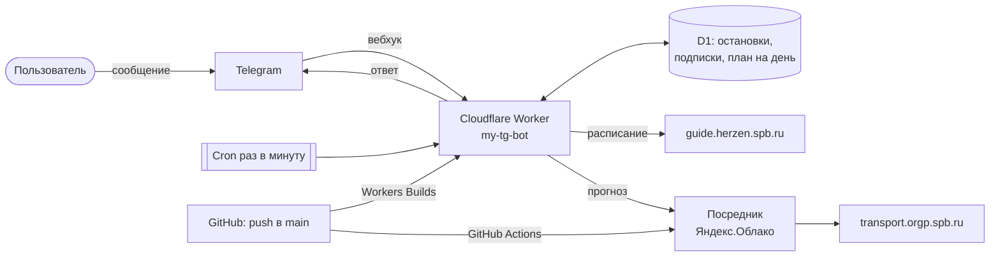

<div align="center">


# Отрок Батракан

**Личный Telegram-бот, верный слуга.**<br>
Покажет расписание пар и подскажет, на чём быстрее доехать домой.

[](https://developers.cloudflare.com/workers/)
[](https://yandex.cloud/ru/services/functions)
[](https://www.typescriptlang.org/)
[](https://core.telegram.org/bots/api)
[](LICENSE)

</div>

<p align="center">
  
</p>

## Что умеет

| Команда | Что делает |
|---|---|
| `/schedule` | Пары на сегодня с сайта РГПУ им. Герцена, кнопкой — на завтра |
| `/uni` | Дорога в вуз: до м. «Комендантский проспект» — что довезёт быстрее и когда выходить |
| `/home` | Дорога домой: остановки, прогноз транспорта, когда сегодня кончаются пары |
| `/id` | Показать свой Telegram ID |
| `/help` | Справка |

Главное меню — кнопки «Домой», «В вуз», «Расписание», «Помощь».

**Сообщение после пар.** Каждое утро бот берёт расписание группы с сайта вуза, находит конец последней пары
и через 30 минут присылает «Пора домой» с прогнозом транспорта. Включается кнопкой «Присылать после пар» в `/home`.

**Дорога в вуз.** До метро «Комендантский проспект» бот сравнивает четыре варианта по времени прибытия
к метро — с учётом пути от дома до остановки, пересадки и пути до метро — и пишет, во сколько выйти из дома:
- троллейбус 50 от «Пр. Авиаконструкторов, угол Плесецкой ул.» (4 мин от дома) прямо до метро (~22 мин утром);

От «Глухарской ул.» (7 мин от дома):
- автобус 171 прямо до метро (~16 мин в пути);
- автобус 170 до ост. «ул. Уточкина, ст. метро» (~20 мин) и 2 мин пешком до метро;
- автобус 85 или 170 до «Шуваловский пр. – Политехнический колледж», 4 мин пешком до «Ул. Шаврова»,
  трамвай 47 или 55 до метро (~10 мин) и 3 мин пешком от трамвайной остановки до метро.

202 не учитывается — он там заканчивает маршрут. Каждое утро бот присылает этот расчёт за 1 ч 2 мин
до начала первой пары (время выхода из дома). Включается кнопкой «Присылать перед парами» в `/uni`.
Варианты и время в пути задаются в `src/journeys.ts`.

## Состояние проекта

| Часть | Состояние |
|---|---|
| Бот на Cloudflare, вебхук, меню, приветствие | работает |
| Расписание с сайта Герцена (группа `24432`) | работает |
| Сообщение через 30 минут после последней пары | работает |
| «В вуз»: расчёт с пересадкой и сообщение за 1 ч 2 мин до первой пары | работает |
| Посредник в Яндекс.Облаке и его автообновление | работает, данные с `transport.orgp.spb.ru` получает |
| Прогноз прибытия и выбор «что быстрее» (автобус 258, трамваи 47/55 у м. «Комендантский проспект») | работает |

**Как считается прогноз.** Три источника, от точного к приблизительному:
1. **Живой прогноз** «Организатора перевозок» — когда машина передаёт координаты.
2. **Фактические прибытия.** Cron раз в минуту (с 5 утра до полуночи) смотрит прогноз по остановкам и
   записывает машины, которые прошли — отсюда «был N мин назад».
3. **Расписание** из справочника GTFS (`src/timetable.json`) — отсюда «ходит каждые ~N мин».

Если живого прогноза по маршруту нет, бот оценивает: последний прибывший + интервал по расписанию
(«≈ через N мин, по интервалу»), а без истории — ближайший рейс по расписанию. Потом отбрасывает машины,
на которые не успеть дойти (поле «минут пешком»), и называет вариант, где окажешься в транспорте раньше всего;
если это оценка, вердикт так и помечен.

**Номер остановки для прогноза** — `stop_id` из справочника GTFS. У начальных остановок он уже задан:
`2068` — автобус 258 в сторону Плесецкой ул., `16644` — трамваи 47/55 в сторону ул. Шаврова.
Для дороги в вуз: `33513` — Глухарская ул. (85, 170, 171), `16017` — Ул. Шаврова (трамваи 47/55 к метро),
`39355` — Пр. Авиаконструкторов, угол Плесецкой ул. (троллейбус 50 к метро).
Остановки для «Домой» хранятся в таблице `stops` базы D1; команд для их изменения в боте нет —
менять через `npx wrangler d1 execute otrok-batrakan --remote --command "..."`.

Известные ограничения:
- Городские сайты Петербурга отвечают облаку нестабильно — посредник повторяет запрос до трёх раз.
- Прогноз «Организатора перевозок» иногда появляется лишь за несколько минут до прибытия, часть машин в нём не видна.

## Как устроено



**Почему две платформы.**
- **Бот — в Cloudflare**, за пределами России: с февраля 2026 года Telegram в России замедляют, и бот на
  российском сервере попал бы под эти ограничения. Cloudflare бесплатен, не требует карты и не засыпает.
- **Посредник — в Яндекс.Облаке**, потому что `transport.orgp.spb.ru` отвечает только российским адресам.
  Посредник ничего не знает о Telegram — только пересылает запросы к сайту транспорта, проверяя пароль.
- Сайт транспорта работает на сертификате **НУЦ Минцифры** и не присылает промежуточный сертификат.
  Посредник доверяет корневому и промежуточному сертификату Минцифры (вшиты в `relay/index.js`,
  проверены по отпечатку) — **только для этого сайта**, остальные соединения проверяются как обычно.

**Что делает cron раз в минуту:** записывает фактические прибытия на остановки, утром загружает расписание пар и планирует
сообщение после пар, после деплоя сверяет меню команд и описание бота с кодом и обновляет их в Telegram.

## Автообновление

Работа идёт так: правка в репозитории → `git push` → нужная часть обновляется сама, в консоли ничего делать не надо.

| Что изменилось | Что обновляется | Чем |
|---|---|---|
| `src/`, `public/`, `wrangler.jsonc`, `package.json`, `package-lock.json`, `tsconfig.json` | бот в Cloudflare | Workers Builds |
| `relay/`, `.github/workflows/relay.yml` | посредник в Яндекс.Облаке | GitHub Actions |
| `README.md`, `design/`, `LICENSE` и прочее | ничего | — |

**Cloudflare: сборка только при изменении бота.** Настраивается в дашборде (из репозитория нельзя):
*Workers & Pages → my-tg-bot → Settings → Build → Build watch paths*:
- **Include paths:** `src/*, public/*, wrangler.jsonc, package.json, package-lock.json, tsconfig.json`
- **Exclude paths:** пусто

**Яндекс.Облако: деплой только при изменении `relay/`.** Уже настроено в
[`.github/workflows/relay.yml`](.github/workflows/relay.yml) (`on.push.paths`). Workflow создаёт новую версию
функции `tg-bot-claudflare` в каталоге `b1gh37ourhg95m0hf5ii`; его можно запустить и вручную — *Actions → Run workflow*.

## Структура

```
src/                  # бот (Cloudflare Worker)
├── index.ts          # точка входа: вебхук, cron, /setup
├── bot.ts            # команды и кнопки
├── db.ts             # база D1 (таблицы создаются сами)
├── schedule.ts       # разбор расписания с сайта вуза
├── commute.ts        # план на день: сообщения перед парами и после, расписание, дорога домой
├── journeys.ts       # дорога в вуз: варианты с пересадкой, выбор по времени у метро
├── transport.ts      # прогноз транспорта через посредника, выбор «что быстрее»
├── routes.json       # номера маршрутов «Организатора перевозок» (scripts/gtfs_routes.py)
├── timetable.json    # расписание прибытий на остановки (scripts/gtfs_timetable.py)
├── telegram.ts       # обёртка над Bot API
├── keyboards.ts      # клавиатуры
├── texts.ts          # все тексты бота, меню команд и описание
└── utils.ts          # разбор команд, времени и т.п.
public/               # раздаётся в интернет: картинки для бота
relay/                # посредник для Яндекс.Облака
.github/workflows/    # автодеплой посредника
scripts/              # обновить routes.json и timetable.json из справочника GTFS
design/               # аватарка и скрипт, которым нарисованы картинки
wrangler.jsonc        # настройки Worker
```

> Всё, что лежит в `public/`, доступно по адресу бота. Не кладите туда ничего личного.

## Настройка с нуля

### 1. Telegram
Создайте бота у [@BotFather](https://t.me/BotFather) и сохраните токен.

### 2. Cloudflare
1. *Workers & Pages → Create → Import a repository* (или у существующего Worker *Settings → Builds → Connect*).
   Build command — пусто, deploy command — `npx wrangler deploy`. Имя Worker должно совпадать с `name` в `wrangler.jsonc`.
2. Настройте **Build watch paths** (см. «Автообновление»).
3. Переменные в *Settings → Variables and Secrets* — см. таблицу секретов ниже.
4. Откройте один раз `https://<worker>.workers.dev/setup?secret=<WEBHOOK_SECRET>&owner=<ваш Telegram ID>` —
   это подключит вебхук и разрешит писать боту только вам (ID узнать у @userinfobot).
   Повторять только после смены токена или `WEBHOOK_SECRET`.

База D1 создаётся при первом деплое, таблицы — при первом запросе, меню команд и описание бот ставит сам.

### 3. Яндекс.Облако
1. **Cloud Functions → Создать функцию**, включить **«Публичная функция»** (чужих отсекает пароль).
2. **IAM → Сервисные аккаунты → Создать** с ролью `functions.editor` → **Создать авторизованный ключ** → скачать JSON.
3. В GitHub добавить секреты `YC_SA_JSON_CREDENTIALS` (JSON целиком) и `RELAY_SECRET`.
4. Указать каталог и имя функции в `.github/workflows/relay.yml` и запустить workflow — код, среда Node.js 22,
   память 128 МБ, таймаут 60 с и переменная `RELAY_SECRET` выставятся сами.
5. Адрес функции (`https://functions.yandexcloud.net/...`) записать в Cloudflare как `RELAY_URL`.

Посредник вызывается около двух раз в минуту (наблюдение за остановками) — порядка 70 тыс. вызовов в месяц
при бесплатном лимите в 1 млн; память функции 128 МБ, чтобы уложиться и в бесплатное время работы.
Для работы функций Яндекс.Облако требует платёжный аккаунт.

### Секреты — где что лежит

| Имя | Cloudflare | GitHub Actions | Яндекс.Облако | Что это |
|---|:-:|:-:|:-:|---|
| `BOT_TOKEN` | да | | | токен от @BotFather |
| `WEBHOOK_SECRET` | да | | | пароль вебхука Telegram |
| `RELAY_URL` | да | | | адрес функции-посредника |
| `RELAY_SECRET` | да | да | да (ставит workflow) | пароль посредника |
| `YC_SA_JSON_CREDENTIALS` | | да | | ключ сервисного аккаунта для деплоя |
| `ALLOWED_IDS` | необязательно | | | ID через запятую — кому можно писать боту (или `owner` в `/setup`) |

> **Секреты — только в этих местах и в локальном `.env`** (он в `.gitignore`). Репозиторий публичный:
> никогда не коммитьте токены и ключи. Токен бота всегда можно снова посмотреть в @BotFather
> (`/mybots` → бот → API Token), остальные пароли — просто задать новые.

### Доступ

Бот отвечает только хозяину. Список разрешённых ID — `ALLOWED_IDS` в настройках Cloudflare плюс список
в базе, который задаёт `/setup?...&owner=ID1,ID2`. Если не задано ни то, ни другое, бот не отвечает никому.
Остальным он один раз (не чаще раза в 6 часов на человека) пишет «Функционал ограничен…» и убирает клавиатуру,
в группах молчит. Сообщения чужих не трогают ни расписание, ни сайт транспорта.

## Разработка

```bash
npm install
npm run typecheck   # проверка типов
npx wrangler dev    # локальный запуск
```

Секреты для локального запуска берутся из `.env`:

```
BOT_TOKEN=...
WEBHOOK_SECRET=...
RELAY_URL=...
RELAY_SECRET=...
```

**Обновить справочные данные** (новые маршруты или остановки): скачать `feed.zip` с компьютера в России
и выполнить `python scripts/gtfs_routes.py feed.zip` и `python scripts/gtfs_timetable.py feed.zip 2068 16644 33513 16017 39355`
(номера всех остановок, для которых нужно расписание).

Посредник можно проверить запросом `GET <RELAY_URL>?probe=1` с заголовком `X-Relay-Secret` —
он покажет, какие сайты сейчас доступны из облака.

## Лицензия

[MIT](LICENSE) © 2026 Leonid Tots
