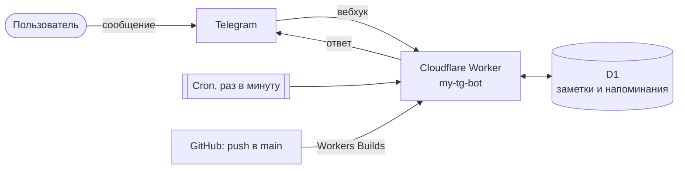

<div align="center">


# Отрок Батракан

**Личный Telegram-бот, верный слуга.**<br>
Запишет, что велишь, напомнит в урочный час и жребий кинет.

[](https://developers.cloudflare.com/workers/)
[](https://www.typescriptlang.org/)
[](https://core.telegram.org/bots/api)
[](LICENSE)

</div>

<p align="center">
  
</p>

## Что умеет

| Команда | Что делает |
|---|---|
| `/note текст` | Записать заметку (без текста — бот спросит сам) |
| `/notes` | Список заметок, удаление кнопками |
| `/remind 1h30m позвонить маме` | Напомнить через указанное время |
| `/reminders` | Активные напоминания, отмена кнопками |
| `/dice`, `/coin` | Кубик и монетка |
| `/random 1 100` | Случайное число в диапазоне |
| `/id` | Показать свой Telegram ID |
| `/help`, `/cancel` | Справка и отмена ввода |

Время в `/remind` задаётся единицами `s`, `m`, `h`, `d`, их можно сочетать: `2d`, `45m`, `1h30m`.
Те же функции доступны через кнопки меню.

## Как устроено



- **Без сервера и без простоя.** Worker просыпается только когда Telegram присылает сообщение.
- **Напоминания** хранятся в базе D1, cron раз в минуту отправляет те, чей срок наступил.
- **Бесплатно.** Укладывается в бесплатный тариф Cloudflare с большим запасом.
- **Автодеплой.** Каждый push в `main` сам собирает и публикует новую версию.

## Структура

```
src/
├── index.ts      # точка входа: вебхук, cron, /setup
├── bot.ts        # команды и кнопки
├── db.ts         # база D1 (таблицы создаются сами)
├── telegram.ts   # обёртка над Bot API
├── keyboards.ts  # клавиатуры
├── texts.ts      # все тексты бота
└── utils.ts      # разбор команд, времени и т.п.
public/           # раздаётся в интернет: картинки для бота
design/           # аватарка и скрипт, которым нарисованы картинки
wrangler.jsonc    # настройки Worker
```

> Всё, что лежит в `public/`, доступно по адресу бота. Не кладите туда ничего личного.

## Развёртывание

1. **Создайте бота** у [@BotFather](https://t.me/BotFather) и сохраните токен.
2. **Подключите репозиторий** в Cloudflare: *Workers & Pages → Create → Import a repository*
   (или для существующего Worker: *Settings → Builds → Connect*). Build command оставьте пустым,
   deploy command — `npx wrangler deploy`. Имя Worker должно совпадать с `name` в `wrangler.jsonc`.
3. **Добавьте переменные** в *Settings → Variables and Secrets*:

   | Имя | Тип | Значение |
   |---|---|---|
   | `BOT_TOKEN` | Secret | токен от @BotFather |
   | `WEBHOOK_SECRET` | Secret | любая строка из `A-Z a-z 0-9 _ -` |
   | `ALLOWED_IDS` | Text, необязательно | ID через запятую — бот будет отвечать только им |
   | `TZ` | Text, необязательно | часовой пояс, по умолчанию `Europe/Moscow` |

4. **Подключите вебхук**, открыв один раз в браузере:
   ```
   https://<ваш-worker>.workers.dev/setup?secret=<WEBHOOK_SECRET>
   ```
   Повторять нужно только после смены токена или секрета.

Остальное бот делает сам:
- база D1 создаётся при первом деплое, таблицы — при первом запросе;
- меню команд и описание бот обновляет в течение минуты после каждого деплоя, если они поменялись в `src/texts.ts`.

> **Секреты — только в Cloudflare и в локальном `.env`.** Файл `.env` в `.gitignore` и в репозиторий не попадает.
> Никогда не коммитьте токен: репозиторий публичный. Токен всегда можно снова посмотреть в @BotFather
> (`/mybots` → бот → API Token), а `WEBHOOK_SECRET` — просто задать новый и открыть `/setup` ещё раз.

## Разработка

```bash
npm install
npm run typecheck   # проверка типов
npx wrangler dev    # локальный запуск
```

Секреты для локального запуска берутся из файла `.env` (он в `.gitignore`):

```
BOT_TOKEN=...
WEBHOOK_SECRET=...
```

## Лицензия

[MIT](LICENSE) © 2026 Leonid Tots
